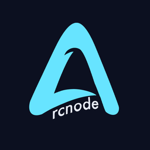

<p align="center">
  
</p>

<h1 align="center">ArcJournal</h1>

<p align="center">
  A private daily journal for Windows, macOS and Linux. End-to-end encrypted, part of
  <a href="https://arcnode.dev">Arcnode</a>.
</p>

<p align="center">
  <a href="https://arcnode.dev/downloads#arcjournal">Download</a> ·
  <a href="https://arcnode.dev/projects/arcjournal">Project page</a> ·
  <a href="CHANGELOG.md">Changelog</a>
</p>

---

## What it does

- **Daily entries** with a rich text editor, a 1 to 10 grade for the day, a mood, colors,
  comments on your own text, attachments and the last ten versions of every entry.
- **A calendar** of every day you wrote, with search and several entries per day.
- **Stats**: streaks, words written, grade and mood trends, your busiest days and months.
- **End-to-end encryption.** Everything you write is encrypted on your computer before it is
  saved. The server stores only ciphertext; nobody else can read your journal, including Arcnode.
- **One Arcnode account** to sign in, with the passkeys and two-factor authentication you
  already set up on arcnode.dev.

## How the encryption works

Each journal has one random 256-bit key. Entries, their versions and their attachments are
sealed with AES-256-GCM using that key, and each sealed entry is bound to its date, so it cannot
be moved to another day without breaking it. Only the calendar date of an entry and when it was
saved are visible to the server.

The journal key itself is stored on the server twice, never in the clear:

1. wrapped by a key derived from your **passphrase** (PBKDF2-SHA256, 600,000 iterations), and
2. wrapped by your **recovery key**, 32 random bytes shown once as 52 letters and numbers.

Changing your passphrase rewraps the key; nothing has to be re-encrypted. If you forget your
passphrase, the recovery key unlocks your journal and sets a new one. If you lose both, the
journal cannot be recovered by anyone; you can only delete it and start over.

You can keep the journal unlocked on a computer you trust. The key is then stored with the
operating system's keychain (Windows DPAPI, macOS Keychain, the Secret Service on Linux). On
Linux without a keychain the option is not offered.

All cryptography is the browser's WebCrypto; see [`client/src/lib/crypto.js`](client/src/lib/crypto.js).

## Signing in

ArcJournal signs in with an Arcnode account through Backboard, Arcnode's identity provider,
using OAuth 2.0 with PKCE in your browser ([RFC 8252](https://www.rfc-editor.org/rfc/rfc8252)).
The app is a public client: it holds no secret, receives the code on a loopback address
(`127.0.0.1:47825` or `47826`) and keeps the refresh token encrypted with the OS keychain in
the main process. The interface only ever sees short-lived access tokens.

Coming from ArcJournal 1.x? Sign in with your Arcnode account, then choose **Used ArcJournal
before? Bring your old journal** and enter your old email or username and password once. Your
entries move over and are encrypted the next time you unlock the journal; the plaintext copies
are then deleted from the server.

## Install

Download the latest version from [arcnode.dev/downloads](https://arcnode.dev/downloads#arcjournal)
or the [releases](https://github.com/stinoooo/ArcJournal/releases).

| System | File | Notes |
| --- | --- | --- |
| Windows 10 and 11 | `ArcJournal-<version>-Setup.exe` | Updates install in the background. |
| macOS 12 or later | `ArcJournal-<version>.dmg` (Apple silicon and Intel) | Not signed yet: the first time, right-click the app and choose **Open**. |
| Debian, Ubuntu | `arcjournal_<version>_amd64.deb` | `sudo apt install ./arcjournal_*.deb` |
| Fedora, openSUSE | `arcjournal-<version>-1.x86_64.rpm` | `sudo dnf install ./arcjournal-*.rpm` |
| Other Linux | `ArcJournal-linux-x64-<version>.zip` | Unzip and run `arcjournal`. |

On macOS and Linux the app tells you when a new version is out and opens the download page.

## Project layout

| Path | What |
| --- | --- |
| `electron/` | Main process: window, `app://` protocol, sign-in, keychain, updates. |
| `client/` | The interface: React 18, Vite 7, TipTap. Encryption in `src/lib/`. |
| `server/` | The API: Express 5, MongoDB. Stores accounts and sealed entries. |
| `assets/` | `icon.png` and the icons built from it (`npm run icons`). |
| `forge.config.js` | Packaging for every platform with Electron Forge. |

## Develop

Needs Node.js 22.12 or later and a MongoDB (local or Docker).

```bash
npm install            # also installs client/ and server/
cp .env.example .env   # then fill in MONGODB_URI and ARCJOURNAL_CLIENT_ID
npm run dev            # API, Vite and Electron together
npm test               # server API tests and client unit tests
```

To try the interface without Backboard or a database, run the throwaway API and the browser
bridge, then open http://localhost:5173:

```bash
node server/dev-server.js
VITE_DEV_BRIDGE=1 VITE_API_URL=http://localhost:8080 npm --prefix client run dev
```

The dev API seeds a 1.x account (`legacy@example.com`, password `legacy-password`) to try
linking and the encryption of old entries.

## Build and release

```bash
npm run make                         # installers for this computer's platform, in out/make
npx electron-forge make --arch=universal   # macOS, both architectures
node tools/smoke.mjs                 # opens the built app and checks the first screen
```

Releases are built by GitHub Actions. Bump the version in `package.json`, `client/package.json`
and `server/package.json`, add it to the changelog, merge to `main` and push a tag `v<version>`.
The [release workflow](.github/workflows/release.yml) builds Windows, macOS and Linux and
attaches everything to a draft release. Publishing the draft makes it the update for everyone.

The API deploys to Railway from `main`; see [DEPLOYMENT.md](DEPLOYMENT.md).

## License

[MIT](LICENSE)
